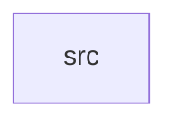

_Generated by CodeAtlas._

## Details

Owns 0 symbols across 1 file(s).

### src

Owns 7 symbols across 4 file(s).

**Related Classes/Methods:** _None_

**Source Files:**

- `crates/api/src/error.rs`
  - `crates.api.src.error.ApiError`
  - `crates.api.src.error.ApiError.from`
  - `crates.api.src.error.ApiError.into_response`
- `crates/api/src/labels.rs`
  - `crates.api.src.labels.flatten_labels`
  - `crates.api.src.labels.profile_field_labels`
- `crates/api/src/main.rs`
  - `crates.api.src.main.main`
- `crates/api/src/state.rs`
  - `crates.api.src.state.AppState`
