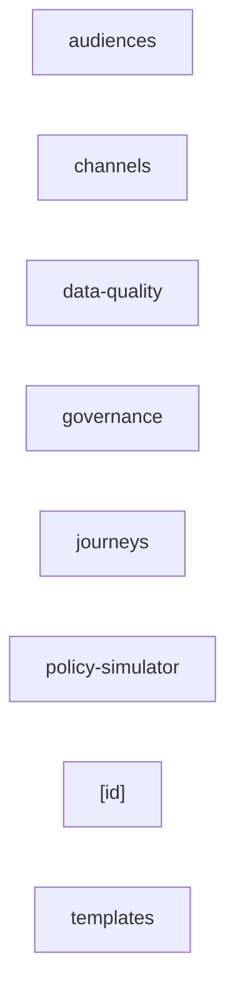

_Generated by CodeAtlas._

## Details

Owns 3 symbols across 4 file(s).

### audiences

Owns 5 symbols across 2 file(s).

**Related Classes/Methods:** _None_

**Source Files:**

- `ui/app/audiences/actions.ts`
  - `ui.app.audiences.actions.activateAudience`
  - `ui.app.audiences.actions.createAudience`
  - `ui.app.audiences.actions.createDestination`
  - `ui.app.audiences.actions.parseAttributeValue`
- `ui/app/audiences/page.tsx`
  - `ui.app.audiences.page.AudiencesPage`

### channels

Owns 2 symbols across 2 file(s).

**Related Classes/Methods:** _None_

**Source Files:**

- `ui/app/channels/actions.ts`
  - `ui.app.channels.actions.createChannel`
- `ui/app/channels/page.tsx`
  - `ui.app.channels.page.ChannelsPage`

### data-quality

Owns 1 symbols across 1 file(s).

**Related Classes/Methods:** _None_

**Source Files:**

- `ui/app/data-quality/page.tsx`
  - `ui.app.data-quality.page.DataQualityPage`

### governance

Owns 2 symbols across 2 file(s).

**Related Classes/Methods:** _None_

**Source Files:**

- `ui/app/governance/actions.ts`
  - `ui.app.governance.actions.createPolicy`
- `ui/app/governance/page.tsx`
  - `ui.app.governance.page.GovernancePage`

### journeys

Owns 4 symbols across 2 file(s).

**Related Classes/Methods:** _None_

**Source Files:**

- `ui/app/journeys/actions.ts`
  - `ui.app.journeys.actions.createJourney`
  - `ui.app.journeys.actions.fail`
  - `ui.app.journeys.actions.startJourney`
- `ui/app/journeys/page.tsx`
  - `ui.app.journeys.page.JourneysPage`

### policy-simulator

Owns 1 symbols across 1 file(s).

**Related Classes/Methods:** _None_

**Source Files:**

- `ui/app/policy-simulator/page.tsx`
  - `ui.app.policy-simulator.page.PolicySimulatorPage`

### [id]

Owns 4 symbols across 2 file(s).

**Related Classes/Methods:** _None_

**Source Files:**

- `ui/app/profiles/[id]/actions.ts`
  - `ui.app.profiles.[id].actions.mergeProfile`
  - `ui.app.profiles.[id].actions.recordConsent`
  - `ui.app.profiles.[id].actions.splitIdentity`
- `ui/app/profiles/[id]/page.tsx`
  - `ui.app.profiles.[id].page.ProfilePage`

### templates

Owns 2 symbols across 2 file(s).

**Related Classes/Methods:** _None_

**Source Files:**

- `ui/app/templates/actions.ts`
  - `ui.app.templates.actions.createTemplate`
- `ui/app/templates/page.tsx`
  - `ui.app.templates.page.TemplatesPage`
