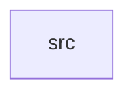

_Generated by CodeAtlas._

## Details

Owns 0 symbols across 1 file(s).

### src

Owns 31 symbols across 4 file(s).

**Related Classes/Methods:** _None_

**Source Files:**

- `crates/audiences/src/eval.rs`
  - `crates.audiences.src.eval.eval_attribute_op`
  - `crates.audiences.src.eval.evaluate_condition`
  - `crates.audiences.src.eval.get_field`
  - `crates.audiences.src.eval.numeric`
  - `crates.audiences.src.eval.tests.contains_on_strings_and_arrays`
  - `crates.audiences.src.eval.tests.equals_and_not_equals`
  - `crates.audiences.src.eval.tests.exists_and_not_exists`
  - `crates.audiences.src.eval.tests.get_field_reads_nested_mixin_value`
  - `crates.audiences.src.eval.tests.greater_than_and_less_than`
- `crates/audiences/src/model.rs`
  - `crates.audiences.src.model.AttributeOp`
  - `crates.audiences.src.model.AudienceDefinition`
  - `crates.audiences.src.model.AudienceDefinition.try_from`
  - `crates.audiences.src.model.AudienceRow`
  - `crates.audiences.src.model.AudienceStatus`
  - `crates.audiences.src.model.Condition`
  - `crates.audiences.src.model.Membership`
  - `crates.audiences.src.model.MembershipChange`
  - `crates.audiences.src.model.MembershipEvent`
  - `crates.audiences.src.model.MembershipKind`
  - `crates.audiences.src.model.default_min_count`
- `crates/audiences/src/repo.rs`
  - `crates.audiences.src.repo.AudienceError`
  - `crates.audiences.src.repo.AudienceRepo`
  - `crates.audiences.src.repo.PgAudienceRepo`
  - `crates.audiences.src.repo.PgAudienceRepo.evaluate_and_sync_membership`
  - `crates.audiences.src.repo.PgAudienceRepo.get`
  - `crates.audiences.src.repo.PgAudienceRepo.get_members`
  - `crates.audiences.src.repo.PgAudienceRepo.get_profile_audiences`
  - `crates.audiences.src.repo.PgAudienceRepo.list`
  - `crates.audiences.src.repo.PgAudienceRepo.log_membership_event`
  - `crates.audiences.src.repo.PgAudienceRepo.new`
  - `crates.audiences.src.repo.PgAudienceRepo.register`
