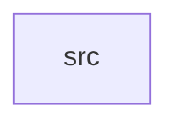

_Generated by CodeAtlas._

## Details

Owns 0 symbols across 1 file(s).

### src

Owns 15 symbols across 4 file(s).

**Related Classes/Methods:** _None_

**Source Files:**

- `crates/channels/src/adapter.rs`
  - `crates.channels.src.adapter.ChannelAdapter`
  - `crates.channels.src.adapter.ChannelError`
  - `crates.channels.src.adapter.WebhookChannelAdapter`
  - `crates.channels.src.adapter.WebhookChannelAdapter.default`
  - `crates.channels.src.adapter.WebhookChannelAdapter.new`
  - `crates.channels.src.adapter.WebhookChannelAdapter.send`
- `crates/channels/src/model.rs`
  - `crates.channels.src.model.Channel`
  - `crates.channels.src.model.RenderedMessage`
- `crates/channels/src/repo.rs`
  - `crates.channels.src.repo.ChannelRepo`
  - `crates.channels.src.repo.ChannelRepoError`
  - `crates.channels.src.repo.PgChannelRepo`
  - `crates.channels.src.repo.PgChannelRepo.get`
  - `crates.channels.src.repo.PgChannelRepo.list`
  - `crates.channels.src.repo.PgChannelRepo.new`
  - `crates.channels.src.repo.PgChannelRepo.register`
