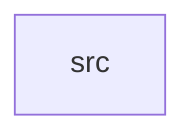

_Generated by CodeAtlas._

## Details

Owns 0 symbols across 1 file(s).

### src

Owns 22 symbols across 4 file(s).

**Related Classes/Methods:** _None_

**Source Files:**

- `crates/connectors/src/model.rs`
  - `crates.connectors.src.model.ActivationRecord`
  - `crates.connectors.src.model.ActivationStatus`
  - `crates.connectors.src.model.Destination`
  - `crates.connectors.src.model.ExportRow`
- `crates/connectors/src/repo.rs`
  - `crates.connectors.src.repo.ActivationRepo`
  - `crates.connectors.src.repo.ConnectorRepoError`
  - `crates.connectors.src.repo.DestinationRepo`
  - `crates.connectors.src.repo.PgConnectorRepo`
  - `crates.connectors.src.repo.PgConnectorRepo.get`
  - `crates.connectors.src.repo.PgConnectorRepo.list`
  - `crates.connectors.src.repo.PgConnectorRepo.list_for_audience`
  - `crates.connectors.src.repo.PgConnectorRepo.log`
  - `crates.connectors.src.repo.PgConnectorRepo.new`
  - `crates.connectors.src.repo.PgConnectorRepo.register`
  - `crates.connectors.src.repo.PgConnectorRepo.replace_staging`
  - `crates.connectors.src.repo.PyReverseEtlExportRepo`
- `crates/connectors/src/webhook.rs`
  - `crates.connectors.src.webhook.ConnectorError`
  - `crates.connectors.src.webhook.DestinationConnector`
  - `crates.connectors.src.webhook.WebhookConnector`
  - `crates.connectors.src.webhook.WebhookConnector.default`
  - `crates.connectors.src.webhook.WebhookConnector.new`
  - `crates.connectors.src.webhook.WebhookConnector.send`
