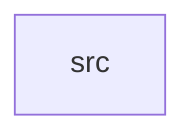

_Generated by CodeAtlas._

## Details

Owns 0 symbols across 1 file(s).

### src

Owns 19 symbols across 7 file(s).

**Related Classes/Methods:** _None_

**Source Files:**

- `crates/core/src/error.rs`
  - `crates.core.src.error.EnvelopeValidationError`
- `crates/core/src/event.rs`
  - `crates.core.src.event.EventEnvelope`
  - `crates.core.src.event.EventEnvelope.validate_shape`
  - `crates.core.src.event.EventSource`
  - `crates.core.src.event.tests.accepts_well_formed_envelope`
  - `crates.core.src.event.tests.base_envelope`
  - `crates.core.src.event.tests.rejects_empty_event_type`
  - `crates.core.src.event.tests.rejects_missing_identity`
- `crates/core/src/identity_ref.rs`
  - `crates.core.src.identity_ref.IdentityRef`
  - `crates.core.src.identity_ref.IdentityRef.default_confidence`
- `crates/core/src/mixin_ref.rs`
  - `crates.core.src.mixin_ref.MixinRef`
  - `crates.core.src.mixin_ref.MixinRef.fmt`
  - `crates.core.src.mixin_ref.MixinRef.parse`
  - `crates.core.src.mixin_ref.MixinRef.standard`
  - `crates.core.src.mixin_ref.tests.parses_custom_namespaced_mixin`
  - `crates.core.src.mixin_ref.tests.parses_standard_mixin_without_namespace`
  - `crates.core.src.mixin_ref.tests.rejects_missing_version`
- `crates/core/src/schema_ref.rs`
  - `crates.core.src.schema_ref.SchemaRef`
  - `crates.core.src.schema_ref.SchemaRef.fmt`
