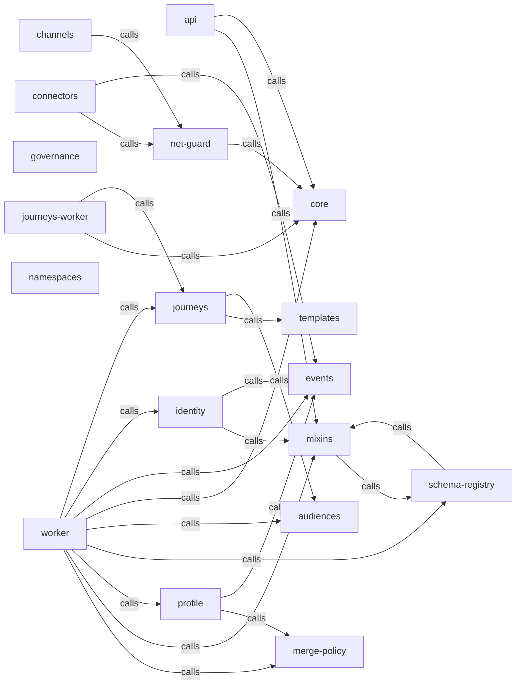

_Generated by CodeAtlas._

## Details

Owns 0 symbols across 0 file(s).

### api

Owns 0 symbols across 1 file(s).

**Related Classes/Methods:** _None_

### audiences

Owns 0 symbols across 1 file(s).

**Related Classes/Methods:** _None_

### channels

Owns 0 symbols across 1 file(s).

**Related Classes/Methods:** _None_

### connectors

Owns 0 symbols across 1 file(s).

**Related Classes/Methods:** _None_

### core

Owns 0 symbols across 1 file(s).

**Related Classes/Methods:** _None_

### events

Owns 0 symbols across 1 file(s).

**Related Classes/Methods:** _None_

### governance

Owns 0 symbols across 1 file(s).

**Related Classes/Methods:** _None_

### identity

Owns 0 symbols across 1 file(s).

**Related Classes/Methods:** _None_

### journeys

Owns 0 symbols across 1 file(s).

**Related Classes/Methods:** _None_

### journeys-worker

Owns 0 symbols across 1 file(s).

**Related Classes/Methods:** _None_

### merge-policy

Owns 0 symbols across 1 file(s).

**Related Classes/Methods:** _None_

### mixins

Owns 0 symbols across 1 file(s).

**Related Classes/Methods:** _None_

### namespaces

Owns 0 symbols across 1 file(s).

**Related Classes/Methods:** _None_

### net-guard

Owns 0 symbols across 1 file(s).

**Related Classes/Methods:** _None_

### profile

Owns 0 symbols across 1 file(s).

**Related Classes/Methods:** _None_

### schema-registry

Owns 0 symbols across 1 file(s).

**Related Classes/Methods:** _None_

### templates

Owns 0 symbols across 1 file(s).

**Related Classes/Methods:** _None_

### worker

Owns 0 symbols across 1 file(s).

**Related Classes/Methods:** _None_
