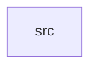

_Generated by CodeAtlas._

## Details

Owns 0 symbols across 1 file(s).

### src

Owns 13 symbols across 5 file(s).

**Related Classes/Methods:** _None_

**Source Files:**

- `crates/events/src/consumer.rs`
  - `crates.events.src.consumer.EventConsumer`
  - `crates.events.src.consumer.EventConsumer.commit`
  - `crates.events.src.consumer.EventConsumer.new`
  - `crates.events.src.consumer.EventConsumer.recv`
  - `crates.events.src.consumer.ReceivedEvent`
- `crates/events/src/error.rs`
  - `crates.events.src.error.EventsError`
- `crates/events/src/producer.rs`
  - `crates.events.src.producer.EventProducer`
  - `crates.events.src.producer.EventProducer.new`
  - `crates.events.src.producer.EventProducer.publish`
  - `crates.events.src.producer.partition_key`
  - `crates.events.src.producer.tests.envelope`
  - `crates.events.src.producer.tests.falls_back_to_first_identity`
  - `crates.events.src.producer.tests.keys_by_primary_identity_when_present`
