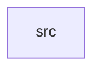

_Generated by CodeAtlas._

## Details

Owns 0 symbols across 1 file(s).

### src

Owns 23 symbols across 4 file(s).

**Related Classes/Methods:** _None_

**Source Files:**

- `crates/governance/src/mapping.rs`
  - `crates.governance.src.mapping.consent_purpose_for_action`
  - `crates.governance.src.mapping.tests.advertising_family_shares_one_purpose`
  - `crates.governance.src.mapping.tests.marketing_actions_map_to_purposes`
  - `crates.governance.src.mapping.tests.operational_actions_need_no_consent`
- `crates/governance/src/model.rs`
  - `crates.governance.src.model.ConsentEvent`
  - `crates.governance.src.model.ConsentState`
  - `crates.governance.src.model.Decision`
  - `crates.governance.src.model.Effect`
  - `crates.governance.src.model.Policy`
  - `crates.governance.src.model.Reason`
- `crates/governance/src/repo.rs`
  - `crates.governance.src.repo.ConsentRepo`
  - `crates.governance.src.repo.GovernanceError`
  - `crates.governance.src.repo.PgGovernanceRepo`
  - `crates.governance.src.repo.PgGovernanceRepo.evaluate_labels`
  - `crates.governance.src.repo.PgGovernanceRepo.get_all_current`
  - `crates.governance.src.repo.PgGovernanceRepo.get_current`
  - `crates.governance.src.repo.PgGovernanceRepo.get_history`
  - `crates.governance.src.repo.PgGovernanceRepo.list`
  - `crates.governance.src.repo.PgGovernanceRepo.new`
  - `crates.governance.src.repo.PgGovernanceRepo.record`
  - `crates.governance.src.repo.PgGovernanceRepo.register`
  - `crates.governance.src.repo.PolicyRepo`
  - `crates.governance.src.repo.to_state`
