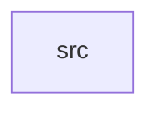

_Generated by CodeAtlas._

## Details

Owns 0 symbols across 1 file(s).

### src

Owns 30 symbols across 5 file(s).

**Related Classes/Methods:** _None_

**Source Files:**

- `crates/identity/src/hash.rs`
  - `crates.identity.src.hash.hash_value`
  - `crates.identity.src.hash.hash_value_with_pepper`
  - `crates.identity.src.hash.pepper_from_env`
  - `crates.identity.src.hash.tests.different_namespace_changes_hash`
  - `crates.identity.src.hash.tests.different_pepper_changes_hash`
  - `crates.identity.src.hash.tests.empty_pepper_matches_unpeppered_legacy_behavior`
  - `crates.identity.src.hash.tests.same_input_hashes_the_same`
  - `crates.identity.src.hash.tests.same_pepper_and_input_hashes_the_same`
- `crates/identity/src/model.rs`
  - `crates.identity.src.model.IdentityAuditEntry`
  - `crates.identity.src.model.IdentityAuditKind`
  - `crates.identity.src.model.IdentityNode`
  - `crates.identity.src.model.ResolvedIdentity`
- `crates/identity/src/repo.rs`
  - `crates.identity.src.repo.IdentityError`
  - `crates.identity.src.repo.IdentityRepo`
  - `crates.identity.src.repo.PgIdentityRepo`
  - `crates.identity.src.repo.PgIdentityRepo.find_profile_id`
  - `crates.identity.src.repo.PgIdentityRepo.get_audit_history`
  - `crates.identity.src.repo.PgIdentityRepo.get_identity_graph`
  - `crates.identity.src.repo.PgIdentityRepo.merge_profiles`
  - `crates.identity.src.repo.PgIdentityRepo.new`
  - `crates.identity.src.repo.PgIdentityRepo.resolve_or_create`
  - `crates.identity.src.repo.PgIdentityRepo.split_identity`
  - `crates.identity.src.repo.merge_one`
- `crates/identity/src/resolve.rs`
  - `crates.identity.src.resolve.pick_canonical`
  - `crates.identity.src.resolve.profiles_to_merge`
  - `crates.identity.src.resolve.tests.claim`
  - `crates.identity.src.resolve.tests.merge_set_excludes_canonical`
  - `crates.identity.src.resolve.tests.no_existing_matches_returns_none`
  - `crates.identity.src.resolve.tests.primary_claim_wins_over_conflicting_matches`
  - `crates.identity.src.resolve.tests.single_match_is_canonical`
