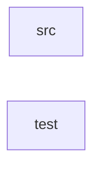

_Generated by CodeAtlas._

## Details

Owns 0 symbols across 3 file(s).

### src

Owns 4 symbols across 1 file(s).

**Related Classes/Methods:** _None_

**Source Files:**

- `edge/ingest-gateway/src/index.ts`
  - `edge.ingest-gateway.src.index.Env`
  - `edge.ingest-gateway.src.index.corsHeaders`
  - `edge.ingest-gateway.src.index.fetch`
  - `edge.ingest-gateway.src.index.isValidEnvelopeShape`

### test

Owns 1 symbols across 1 file(s).

**Related Classes/Methods:** _None_

**Source Files:**

- `edge/ingest-gateway/test/index.test.ts`
  - `edge.ingest-gateway.test.index.test.validEnvelope`
