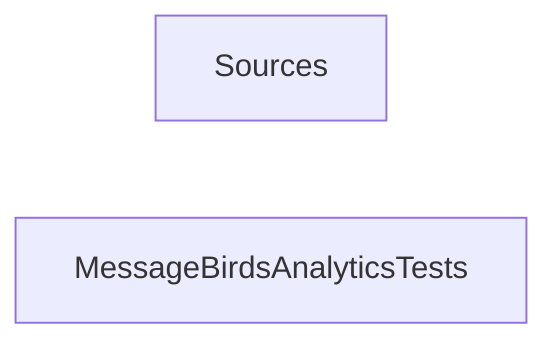

_Generated by CodeAtlas._

## Details

Owns 0 symbols across 1 file(s).

### Sources

Owns 0 symbols across 0 file(s).

**Related Classes/Methods:** _None_

### MessageBirdsAnalyticsTests

Owns 0 symbols across 3 file(s).

**Related Classes/Methods:** _None_
