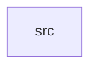

_Generated by CodeAtlas._

## Details

Owns 0 symbols across 1 file(s).

### src

Owns 48 symbols across 6 file(s).

**Related Classes/Methods:** _None_

**Source Files:**

- `crates/journeys/src/engine.rs`
  - `crates.journeys.src.engine.Engine`
  - `crates.journeys.src.engine.Engine.advance_run`
  - `crates.journeys.src.engine.Engine.complete`
  - `crates.journeys.src.engine.Engine.execute_action`
  - `crates.journeys.src.engine.Engine.is_suppressed`
  - `crates.journeys.src.engine.Engine.log_event`
  - `crates.journeys.src.engine.Engine.profile_mixins`
  - `crates.journeys.src.engine.Engine.set_waiting`
  - `crates.journeys.src.engine.Engine.transition`
- `crates/journeys/src/error.rs`
  - `crates.journeys.src.error.JourneyError`
- `crates/journeys/src/model.rs`
  - `crates.journeys.src.model.ContactPolicy`
  - `crates.journeys.src.model.JourneyDefinition`
  - `crates.journeys.src.model.JourneyDefinition.try_from`
  - `crates.journeys.src.model.JourneyRow`
  - `crates.journeys.src.model.JourneyRun`
  - `crates.journeys.src.model.JourneyRunEvent`
  - `crates.journeys.src.model.JourneyStatus`
  - `crates.journeys.src.model.MessageSent`
  - `crates.journeys.src.model.MessageStatus`
  - `crates.journeys.src.model.Node`
  - `crates.journeys.src.model.NodeKind`
  - `crates.journeys.src.model.RunEventKind`
  - `crates.journeys.src.model.RunStatus`
  - `crates.journeys.src.model.SplitBranch`
  - `crates.journeys.src.model.StepOutcome`
  - `crates.journeys.src.model.Trigger`
- `crates/journeys/src/repo.rs`
  - `crates.journeys.src.repo.ContactPolicyRepo`
  - `crates.journeys.src.repo.JourneyRepo`
  - `crates.journeys.src.repo.PgJourneyRepo`
  - `crates.journeys.src.repo.PgJourneyRepo.advance_due_runs`
  - `crates.journeys.src.repo.PgJourneyRepo.find_by_audience_trigger`
  - `crates.journeys.src.repo.PgJourneyRepo.get`
  - `crates.journeys.src.repo.PgJourneyRepo.get_profile_runs`
  - `crates.journeys.src.repo.PgJourneyRepo.get_run_events`
  - `crates.journeys.src.repo.PgJourneyRepo.get_runs`
  - `crates.journeys.src.repo.PgJourneyRepo.list`
  - `crates.journeys.src.repo.PgJourneyRepo.list_policies`
  - `crates.journeys.src.repo.PgJourneyRepo.new`
  - `crates.journeys.src.repo.PgJourneyRepo.register`
  - `crates.journeys.src.repo.PgJourneyRepo.register_policy`
  - `crates.journeys.src.repo.PgJourneyRepo.run_to_completion_or_pause`
  - `crates.journeys.src.repo.PgJourneyRepo.start_run`
- `crates/journeys/src/split.rs`
  - `crates.journeys.src.split.choose_branch`
  - `crates.journeys.src.split.tests.branches`
  - `crates.journeys.src.split.tests.different_profiles_can_land_in_different_branches`
  - `crates.journeys.src.split.tests.distribution_is_roughly_even_over_many_profiles`
  - `crates.journeys.src.split.tests.same_profile_and_node_always_picks_same_branch`
  - `crates.journeys.src.split.tests.single_branch_always_wins`
