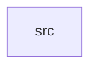

_Generated by CodeAtlas._

## Details

Owns 0 symbols across 1 file(s).

### src

Owns 1 symbols across 1 file(s).

**Related Classes/Methods:** _None_

**Source Files:**

- `crates/journeys-worker/src/main.rs`
  - `crates.journeys-worker.src.main.main`
