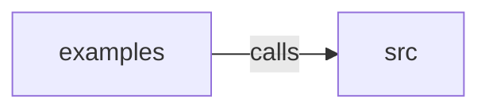

_Generated by CodeAtlas._

## Details

Owns 0 symbols across 2 file(s).

### examples

Owns 2 symbols across 1 file(s).

**Related Classes/Methods:** _None_

**Source Files:**

- `sdk/js/examples/smoke-test.ts`
  - `sdk.js.examples.smoke-test.main`
  - `sdk.js.examples.smoke-test.sleep`

### src

Owns 42 symbols across 2 file(s).

**Related Classes/Methods:** _None_

**Source Files:**

- `sdk/js/src/client.ts`
  - `sdk.js.src.client.ApiError`
  - `sdk.js.src.client.ApiError.constructor`
  - `sdk.js.src.client.MessageBirdsClient`
  - `sdk.js.src.client.MessageBirdsClient.constructor`
  - `sdk.js.src.client.MessageBirdsClient.findProfileByIdentity`
  - `sdk.js.src.client.MessageBirdsClient.getProfile`
  - `sdk.js.src.client.MessageBirdsClient.sendEvent`
  - `sdk.js.src.client.MessageBirdsClientOptions`
- `sdk/js/src/types.ts`
  - `sdk.js.src.types.ActivationSummary`
  - `sdk.js.src.types.AudienceDefinition`
  - `sdk.js.src.types.BlockedProfile`
  - `sdk.js.src.types.Channel`
  - `sdk.js.src.types.ConsentEvent`
  - `sdk.js.src.types.ConsentState`
  - `sdk.js.src.types.ConsentView`
  - `sdk.js.src.types.ContactPolicy`
  - `sdk.js.src.types.DeadLetterEventView`
  - `sdk.js.src.types.Destination`
  - `sdk.js.src.types.EventDetail`
  - `sdk.js.src.types.EventEnvelope`
  - `sdk.js.src.types.EventSource`
  - `sdk.js.src.types.EventSummary`
  - `sdk.js.src.types.FieldDef`
  - `sdk.js.src.types.FieldProvenance`
  - `sdk.js.src.types.IdentityAuditEntry`
  - `sdk.js.src.types.IdentityNode`
  - `sdk.js.src.types.IdentityRef`
  - `sdk.js.src.types.IdentityView`
  - `sdk.js.src.types.JourneyDefinition`
  - `sdk.js.src.types.JourneyRun`
  - `sdk.js.src.types.JourneyRunEvent`
  - `sdk.js.src.types.Membership`
  - `sdk.js.src.types.MergeSuggestion`
  - `sdk.js.src.types.MessageTemplate`
  - `sdk.js.src.types.MixinDef`
  - `sdk.js.src.types.Policy`
  - `sdk.js.src.types.PolicySimulateResponse`
  - `sdk.js.src.types.ProfileView`
  - `sdk.js.src.types.RenderedTemplate`
  - `sdk.js.src.types.SchemaDefinition`
  - `sdk.js.src.types.SchemaRef`
  - `sdk.js.src.types.SplitBranch`
