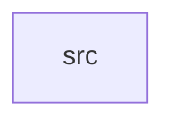

_Generated by CodeAtlas._

## Details

Owns 0 symbols across 1 file(s).

### src

Owns 22 symbols across 4 file(s).

**Related Classes/Methods:** _None_

**Source Files:**

- `crates/merge-policy/src/apply.rs`
  - `crates.merge-policy.src.apply.MergePolicyError`
  - `crates.merge-policy.src.apply.apply_policy`
  - `crates.merge-policy.src.apply.latest`
  - `crates.merge-policy.src.apply.source_priority`
  - `crates.merge-policy.src.apply.tests.candidate`
  - `crates.merge-policy.src.apply.tests.latest_timestamp_picks_most_recent`
  - `crates.merge-policy.src.apply.tests.no_candidates_returns_none`
  - `crates.merge-policy.src.apply.tests.policy`
  - `crates.merge-policy.src.apply.tests.source_priority_falls_back_to_latest_when_unconfigured`
  - `crates.merge-policy.src.apply.tests.source_priority_honors_configured_order`
  - `crates.merge-policy.src.apply.tests.unimplemented_strategy_errors_explicitly`
- `crates/merge-policy/src/model.rs`
  - `crates.merge-policy.src.model.FieldCandidate`
  - `crates.merge-policy.src.model.MergePolicy`
  - `crates.merge-policy.src.model.MergePolicy.default_for_tenant`
  - `crates.merge-policy.src.model.Strategy`
  - `crates.merge-policy.src.model.Strategy.is_implemented`
- `crates/merge-policy/src/repo.rs`
  - `crates.merge-policy.src.repo.MergePolicyRepo`
  - `crates.merge-policy.src.repo.MergePolicyRepoError`
  - `crates.merge-policy.src.repo.PgMergePolicyRepo`
  - `crates.merge-policy.src.repo.PgMergePolicyRepo.get_active`
  - `crates.merge-policy.src.repo.PgMergePolicyRepo.new`
  - `crates.merge-policy.src.repo.PgMergePolicyRepo.register`
