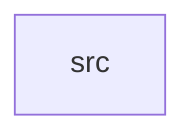

_Generated by CodeAtlas._

## Details

Owns 0 symbols across 1 file(s).

### src

Owns 19 symbols across 5 file(s).

**Related Classes/Methods:** _None_

**Source Files:**

- `crates/mixins/src/compose.rs`
  - `crates.mixins.src.compose.validate_mixin_fields`
- `crates/mixins/src/model.rs`
  - `crates.mixins.src.model.MixinDef`
  - `crates.mixins.src.model.MixinDef.key`
  - `crates.mixins.src.model.MixinDef.try_from`
  - `crates.mixins.src.model.MixinRow`
  - `crates.mixins.src.model.MixinStatus`
- `crates/mixins/src/repo.rs`
  - `crates.mixins.src.repo.MixinError`
  - `crates.mixins.src.repo.MixinRepo`
  - `crates.mixins.src.repo.PgMixinRepo`
  - `crates.mixins.src.repo.PgMixinRepo.get`
  - `crates.mixins.src.repo.PgMixinRepo.get_latest`
  - `crates.mixins.src.repo.PgMixinRepo.insert`
  - `crates.mixins.src.repo.PgMixinRepo.list`
  - `crates.mixins.src.repo.PgMixinRepo.new`
  - `crates.mixins.src.repo.PgMixinRepo.register_custom`
  - `crates.mixins.src.repo.PgMixinRepo.seed_standard_library`
- `crates/mixins/src/standard.rs`
  - `crates.mixins.src.standard.StandardMixinSpec`
  - `crates.mixins.src.standard.standard_library`
  - `crates.mixins.src.standard.tests.standard_library_loads_all_four_mixins`
