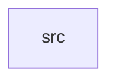

_Generated by CodeAtlas._

## Details

Owns 0 symbols across 1 file(s).

### src

Owns 9 symbols across 3 file(s).

**Related Classes/Methods:** _None_

**Source Files:**

- `crates/namespaces/src/model.rs`
  - `crates.namespaces.src.model.Namespace`
  - `crates.namespaces.src.model.NamespaceKind`
- `crates/namespaces/src/repo.rs`
  - `crates.namespaces.src.repo.NamespaceError`
  - `crates.namespaces.src.repo.NamespaceRepo`
  - `crates.namespaces.src.repo.PgNamespaceRepo`
  - `crates.namespaces.src.repo.PgNamespaceRepo.get`
  - `crates.namespaces.src.repo.PgNamespaceRepo.list`
  - `crates.namespaces.src.repo.PgNamespaceRepo.new`
  - `crates.namespaces.src.repo.PgNamespaceRepo.register`
