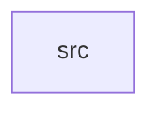

_Generated by CodeAtlas._

## Details

Owns 0 symbols across 1 file(s).

### src

Owns 18 symbols across 1 file(s).

**Related Classes/Methods:** _None_

**Source Files:**

- `crates/net-guard/src/lib.rs`
  - `crates.net-guard.src.lib.OutboundUrlError`
  - `crates.net-guard.src.lib.SsrfGuardResolver`
  - `crates.net-guard.src.lib.SsrfGuardResolver.resolve`
  - `crates.net-guard.src.lib.guard_enabled`
  - `crates.net-guard.src.lib.harden_client`
  - `crates.net-guard.src.lib.ip_literal_is_blocked`
  - `crates.net-guard.src.lib.is_benchmark_v4`
  - `crates.net-guard.src.lib.is_blocked_ip`
  - `crates.net-guard.src.lib.is_blocked_v4`
  - `crates.net-guard.src.lib.is_blocked_v6`
  - `crates.net-guard.src.lib.is_cgnat_v4`
  - `crates.net-guard.src.lib.is_documentation_v6`
  - `crates.net-guard.src.lib.is_reserved_v4`
  - `crates.net-guard.src.lib.is_unique_local_v6`
  - `crates.net-guard.src.lib.tests.blocks_cgnat_benchmark_and_reserved`
  - `crates.net-guard.src.lib.tests.detects_blocked_ip_literals`
  - `crates.net-guard.src.lib.tests.rejects_non_http_schemes_and_garbage`
  - `crates.net-guard.src.lib.validate_outbound_url`
