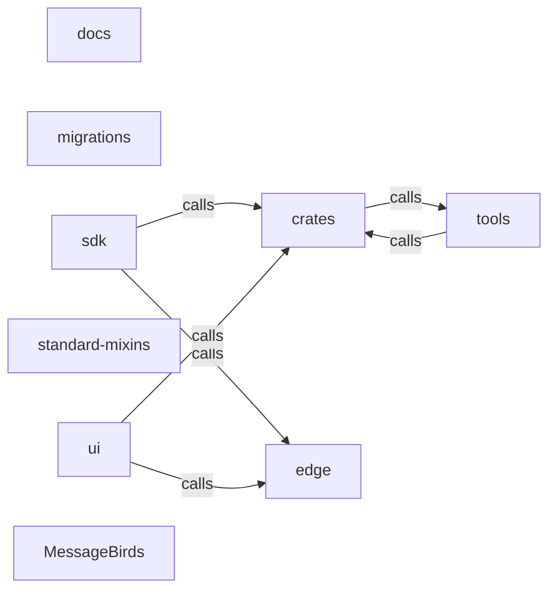

_Generated by CodeAtlas._

## Details

Architecture map of MessageBirds.

### crates

Owns 0 symbols across 0 file(s).

**Related Classes/Methods:** _None_

### docs

Owns 0 symbols across 2 file(s).

**Related Classes/Methods:** _None_

### edge

Owns 0 symbols across 0 file(s).

**Related Classes/Methods:** _None_

### migrations

Owns 0 symbols across 17 file(s).

**Related Classes/Methods:** _None_

### sdk

Owns 0 symbols across 0 file(s).

**Related Classes/Methods:** _None_

### standard-mixins

Owns 0 symbols across 4 file(s).

**Related Classes/Methods:** _None_

### tools

Owns 0 symbols across 0 file(s).

**Related Classes/Methods:** _None_

### ui

Owns 0 symbols across 4 file(s).

**Related Classes/Methods:** _None_

### MessageBirds

Owns 0 symbols across 13 file(s).

**Related Classes/Methods:** _None_
