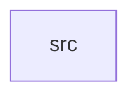

_Generated by CodeAtlas._

## Details

Owns 0 symbols across 1 file(s).

### src

Owns 22 symbols across 5 file(s).

**Related Classes/Methods:** _None_

**Source Files:**

- `crates/profile/src/decide.rs`
  - `crates.profile.src.decide.Decision`
  - `crates.profile.src.decide.decide`
  - `crates.profile.src.decide.tests.newer_incoming_value_updates`
  - `crates.profile.src.decide.tests.no_existing_value_always_updates`
  - `crates.profile.src.decide.tests.older_incoming_value_is_unchanged`
  - `crates.profile.src.decide.tests.policy`
- `crates/profile/src/model.rs`
  - `crates.profile.src.model.FieldProvenance`
  - `crates.profile.src.model.Profile`
- `crates/profile/src/repo.rs`
  - `crates.profile.src.repo.PgProfileRepo`
  - `crates.profile.src.repo.PgProfileRepo.apply_mixin_update`
  - `crates.profile.src.repo.PgProfileRepo.get`
  - `crates.profile.src.repo.PgProfileRepo.get_provenance`
  - `crates.profile.src.repo.PgProfileRepo.new`
  - `crates.profile.src.repo.ProfileError`
  - `crates.profile.src.repo.ProfileRepo`
- `crates/profile/src/similarity.rs`
  - `crates.profile.src.similarity.PersonSignal`
  - `crates.profile.src.similarity.name_similarity`
  - `crates.profile.src.similarity.score`
  - `crates.profile.src.similarity.tests.identical_device_and_name_scores_high`
  - `crates.profile.src.similarity.tests.no_shared_signals_scores_zero`
  - `crates.profile.src.similarity.tests.shared_device_alone_caps_at_half`
  - `crates.profile.src.similarity.tests.similar_names_score_higher_than_dissimilar`
