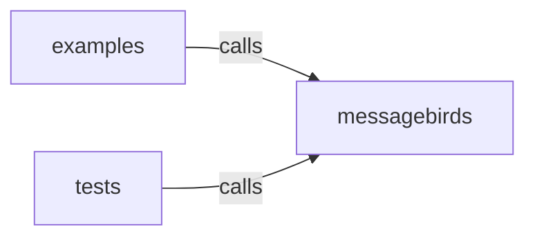

_Generated by CodeAtlas._

## Details

Owns 0 symbols across 3 file(s).

### examples

Owns 1 symbols across 1 file(s).

**Related Classes/Methods:** _None_

**Source Files:**

- `sdk/python/examples/smoke_test.py`
  - `sdk.python.examples.smoke_test.main`

### messagebirds

Owns 42 symbols across 4 file(s).

**Related Classes/Methods:** _None_

**Source Files:**

- `sdk/python/src/messagebirds/client.py`
  - `sdk.python.src.messagebirds.client.ApiError`
  - `sdk.python.src.messagebirds.client.ApiError.__init__`
  - `sdk.python.src.messagebirds.client.MessageBirdsClient`
  - `sdk.python.src.messagebirds.client.MessageBirdsClient.__init__`
  - `sdk.python.src.messagebirds.client.MessageBirdsClient.find_profile_by_identity`
  - `sdk.python.src.messagebirds.client.MessageBirdsClient.get_profile`
  - `sdk.python.src.messagebirds.client.MessageBirdsClient.send_event`
- `sdk/python/src/messagebirds/types.py`
  - `sdk.python.src.messagebirds.types.ActivationSummary`
  - `sdk.python.src.messagebirds.types.AudienceDefinition`
  - `sdk.python.src.messagebirds.types.BlockedProfile`
  - `sdk.python.src.messagebirds.types.Channel`
  - `sdk.python.src.messagebirds.types.ConsentEvent`
  - `sdk.python.src.messagebirds.types.ConsentState`
  - `sdk.python.src.messagebirds.types.ConsentSummary`
  - `sdk.python.src.messagebirds.types.ConsentView`
  - `sdk.python.src.messagebirds.types.ContactPolicy`
  - `sdk.python.src.messagebirds.types.DeadLetterEventView`
  - `sdk.python.src.messagebirds.types.Destination`
  - `sdk.python.src.messagebirds.types.EventDetail`
  - `sdk.python.src.messagebirds.types.EventEnvelope`
  - `sdk.python.src.messagebirds.types.EventSource`
  - `sdk.python.src.messagebirds.types.EventSummary`
  - `sdk.python.src.messagebirds.types.FieldDef`
  - `sdk.python.src.messagebirds.types.FieldProvenance`
  - `sdk.python.src.messagebirds.types.IdentityAuditEntry`
  - `sdk.python.src.messagebirds.types.IdentityNode`
  - `sdk.python.src.messagebirds.types.IdentityRef`
  - `sdk.python.src.messagebirds.types.IdentityView`
  - `sdk.python.src.messagebirds.types.JourneyDefinition`
  - `sdk.python.src.messagebirds.types.JourneyRun`
  - `sdk.python.src.messagebirds.types.JourneyRunEvent`
  - `sdk.python.src.messagebirds.types.Membership`
  - `sdk.python.src.messagebirds.types.MergeSuggestion`
  - `sdk.python.src.messagebirds.types.MessageTemplate`
  - `sdk.python.src.messagebirds.types.MixinDef`
  - `sdk.python.src.messagebirds.types.Policy`
  - `sdk.python.src.messagebirds.types.PolicySimulateResponse`
  - `sdk.python.src.messagebirds.types.ProfileView`
  - `sdk.python.src.messagebirds.types.RenderedTemplate`
  - `sdk.python.src.messagebirds.types.SchemaDefinition`
  - `sdk.python.src.messagebirds.types.SchemaRef`
  - `sdk.python.src.messagebirds.types.SplitBranch`

### tests

Owns 12 symbols across 1 file(s).

**Related Classes/Methods:** _None_

**Source Files:**

- `sdk/python/tests/test_client.py`
  - `sdk.python.tests.test_client.FakeApiHandler`
  - `sdk.python.tests.test_client.FakeApiHandler._write`
  - `sdk.python.tests.test_client.FakeApiHandler.do_GET`
  - `sdk.python.tests.test_client.FakeApiHandler.do_POST`
  - `sdk.python.tests.test_client.FakeApiHandler.log_message`
  - `sdk.python.tests.test_client.client`
  - `sdk.python.tests.test_client.test_find_profile_by_identity_found`
  - `sdk.python.tests.test_client.test_find_profile_by_identity_missing_returns_none`
  - `sdk.python.tests.test_client.test_get_profile_error_raises_api_error`
  - `sdk.python.tests.test_client.test_get_profile_found`
  - `sdk.python.tests.test_client.test_get_profile_missing_returns_none`
  - `sdk.python.tests.test_client.test_send_event`
