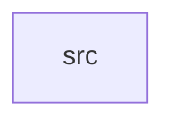

_Generated by CodeAtlas._

## Details

Owns 0 symbols across 1 file(s).

### src

Owns 31 symbols across 5 file(s).

**Related Classes/Methods:** _None_

**Source Files:**

- `crates/schema-registry/src/compatibility.rs`
  - `crates.schema-registry.src.compatibility.check_backward_compatible`
  - `crates.schema-registry.src.compatibility.tests.adding_optional_field_is_compatible`
  - `crates.schema-registry.src.compatibility.tests.changing_field_type_is_breaking`
  - `crates.schema-registry.src.compatibility.tests.dropping_required_field_is_breaking`
  - `crates.schema-registry.src.compatibility.tests.new_required_field_is_breaking`
  - `crates.schema-registry.src.compatibility.tests.schema`
- `crates/schema-registry/src/model.rs`
  - `crates.schema-registry.src.model.FieldDef`
  - `crates.schema-registry.src.model.FieldType`
  - `crates.schema-registry.src.model.FieldType.matches`
  - `crates.schema-registry.src.model.Schema`
  - `crates.schema-registry.src.model.Schema.try_from`
  - `crates.schema-registry.src.model.SchemaRow`
  - `crates.schema-registry.src.model.SchemaStatus`
- `crates/schema-registry/src/repo.rs`
  - `crates.schema-registry.src.repo.PgSchemaRepo`
  - `crates.schema-registry.src.repo.PgSchemaRepo.get`
  - `crates.schema-registry.src.repo.PgSchemaRepo.get_latest`
  - `crates.schema-registry.src.repo.PgSchemaRepo.latest_row`
  - `crates.schema-registry.src.repo.PgSchemaRepo.list`
  - `crates.schema-registry.src.repo.PgSchemaRepo.new`
  - `crates.schema-registry.src.repo.PgSchemaRepo.register`
  - `crates.schema-registry.src.repo.SchemaError`
  - `crates.schema-registry.src.repo.SchemaRepo`
- `crates/schema-registry/src/validate.rs`
  - `crates.schema-registry.src.validate.FieldViolation`
  - `crates.schema-registry.src.validate.FieldViolation.fmt`
  - `crates.schema-registry.src.validate.tests.missing_required_field_is_reported`
  - `crates.schema-registry.src.validate.tests.product_view_schema`
  - `crates.schema-registry.src.validate.tests.valid_payload_has_no_violations`
  - `crates.schema-registry.src.validate.tests.wrong_type_is_reported`
  - `crates.schema-registry.src.validate.type_name`
  - `crates.schema-registry.src.validate.validate_fields`
  - `crates.schema-registry.src.validate.validate_payload`
