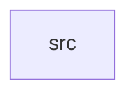

_Generated by CodeAtlas._

## Details

Owns 0 symbols across 1 file(s).

### src

Owns 18 symbols across 4 file(s).

**Related Classes/Methods:** _None_

**Source Files:**

- `crates/templates/src/model.rs`
  - `crates.templates.src.model.MessageTemplate`
  - `crates.templates.src.model.RenderedTemplate`
- `crates/templates/src/render.rs`
  - `crates.templates.src.render.lookup`
  - `crates.templates.src.render.render`
  - `crates.templates.src.render.render_str`
  - `crates.templates.src.render.tests.handles_multiple_and_adjacent_variables`
  - `crates.templates.src.render.tests.non_string_values_are_stringified`
  - `crates.templates.src.render.tests.reports_missing_variables_as_empty_string`
  - `crates.templates.src.render.tests.substitutes_present_variables`
  - `crates.templates.src.render.tests.template`
- `crates/templates/src/repo.rs`
  - `crates.templates.src.repo.PgTemplateRepo`
  - `crates.templates.src.repo.PgTemplateRepo.get`
  - `crates.templates.src.repo.PgTemplateRepo.get_latest`
  - `crates.templates.src.repo.PgTemplateRepo.list`
  - `crates.templates.src.repo.PgTemplateRepo.new`
  - `crates.templates.src.repo.PgTemplateRepo.register`
  - `crates.templates.src.repo.TemplateError`
  - `crates.templates.src.repo.TemplateRepo`
