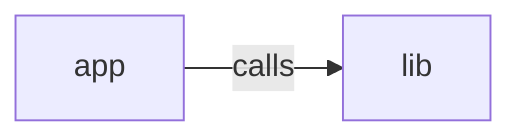

_Generated by CodeAtlas._

## Details

Owns 0 symbols across 4 file(s).

### app

Owns 3 symbols across 4 file(s).

**Related Classes/Methods:** _None_

**Source Files:**

- `ui/app/actions.ts`
  - `ui.app.actions.lookupProfile`
- `ui/app/layout.tsx`
  - `ui.app.layout.RootLayout`
- `ui/app/page.tsx`
  - `ui.app.page.HomePage`

### lib

Owns 3 symbols across 1 file(s).

**Related Classes/Methods:** _None_

**Source Files:**

- `ui/lib/api.ts`
  - `ui.lib.api.ApiError`
  - `ui.lib.api.ApiError.constructor`
  - `ui.lib.api.apiFetch`
