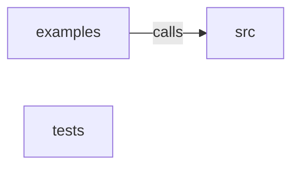

_Generated by CodeAtlas._

## Details

Owns 0 symbols across 2 file(s).

### examples

Owns 3 symbols across 1 file(s).

**Related Classes/Methods:** _None_

**Source Files:**

- `sdk/web/examples/smoke-test.ts`
  - `sdk.web.examples.smoke-test.findProfileByIdentity`
  - `sdk.web.examples.smoke-test.main`
  - `sdk.web.examples.smoke-test.sleep`

### src

Owns 22 symbols across 4 file(s).

**Related Classes/Methods:** _None_

**Source Files:**

- `sdk/web/src/client.ts`
  - `sdk.web.src.client.MessageBirdsWebAnalytics`
  - `sdk.web.src.client.MessageBirdsWebAnalytics.constructor`
  - `sdk.web.src.client.MessageBirdsWebAnalytics.destroy`
  - `sdk.web.src.client.MessageBirdsWebAnalytics.flush`
  - `sdk.web.src.client.MessageBirdsWebAnalytics.flushBeacon`
  - `sdk.web.src.client.MessageBirdsWebAnalytics.identify`
  - `sdk.web.src.client.MessageBirdsWebAnalytics.loadOrCreateAnonymousId`
  - `sdk.web.src.client.MessageBirdsWebAnalytics.sendOnce`
  - `sdk.web.src.client.MessageBirdsWebAnalytics.track`
  - `sdk.web.src.client.MessageBirdsWebAnalyticsOptions`
- `sdk/web/src/memory-storage.ts`
  - `sdk.web.src.memory-storage.InMemoryStorage`
  - `sdk.web.src.memory-storage.InMemoryStorage.getItem`
  - `sdk.web.src.memory-storage.InMemoryStorage.setItem`
- `sdk/web/src/queue.ts`
  - `sdk.web.src.queue.EventQueue`
  - `sdk.web.src.queue.EventQueue.constructor`
  - `sdk.web.src.queue.EventQueue.enqueue`
  - `sdk.web.src.queue.EventQueue.flush`
  - `sdk.web.src.queue.EventQueue.load`
  - `sdk.web.src.queue.EventQueue.persist`
  - `sdk.web.src.queue.QueueStorage`
  - `sdk.web.src.queue.QueuedEvent`
  - `sdk.web.src.queue.backoffMs`

### tests

Owns 1 symbols across 1 file(s).

**Related Classes/Methods:** _None_

**Source Files:**

- `sdk/web/tests/queue.test.ts`
  - `sdk.web.tests.queue.test.envelope`
