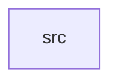

_Generated by CodeAtlas._

## Details

Owns 0 symbols across 1 file(s).

### src

Owns 12 symbols across 4 file(s).

**Related Classes/Methods:** _None_

**Source Files:**

- `crates/worker/src/identity_mixin.rs`
  - `crates.worker.src.identity_mixin.derive_identity_mixin_fields`
  - `crates.worker.src.identity_mixin.tests.claim`
  - `crates.worker.src.identity_mixin.tests.ignores_unmapped_namespaces`
  - `crates.worker.src.identity_mixin.tests.maps_known_namespaces_and_primary_flag`
- `crates/worker/src/main.rs`
  - `crates.worker.src.main.main`
- `crates/worker/src/persist.rs`
  - `crates.worker.src.persist.persist_dead_letter`
  - `crates.worker.src.persist.persist_event`
- `crates/worker/src/pipeline.rs`
  - `crates.worker.src.pipeline.Outcome`
  - `crates.worker.src.pipeline.Pipeline`
  - `crates.worker.src.pipeline.Pipeline.process`
  - `crates.worker.src.pipeline.Pipeline.reject`
  - `crates.worker.src.pipeline.WorkerError`
